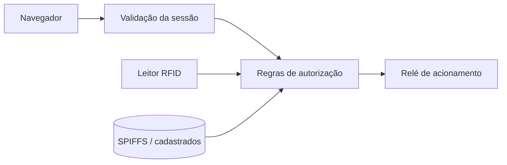

# Arquitetura — visão experimental

O acesso HTTP ocorre em rede local e **não tem TLS embutido**. Canal Bluetooth de comando foi desativado. Validação de sessão rejeita cookies arbitrários; a sessão expira com reboot, mas não substitui transporte seguro. A versão atual ainda não tem autenticador criptográfico para tags RFID clonáveis.
